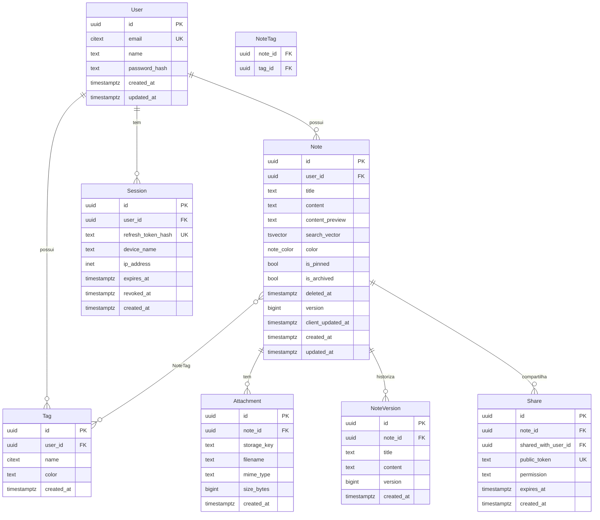

# Modelo de dados

PostgreSQL 17. Toda tabela usa `uuid` v7 como chave primária — ordenável no tempo,
o que preserva a localidade de índice sem revelar sequência de crescimento como um
`serial` faria.

## Diagrama



> **Fora de escopo**: cadernos (organização hierárquica) não fazem parte desta
> versão. A organização das notas fica por conta das tags. Se voltarem, entram
> como tabela nova mais uma coluna anulável em `notes` — migration aditiva.
>
> **Escopo da v1**: `User` guarda apenas nome completo, e-mail, senha e as datas.
> Avatar, preferências de interface e verificação de e-mail entram em fases
> posteriores — como colunas anuláveis, o que os torna uma migration aditiva e
> uma mudança retrocompatível de contrato.

## Decisões por trás do modelo

### `citext` para e-mail e nome de tag

`Joao@Exemplo.com` e `joao@exemplo.com` são a mesma pessoa; `Trabalho` e `trabalho`
são a mesma tag. Resolver isso no tipo da coluna evita normalização espalhada pela
aplicação — e o índice único passa a valer de fato.

### `deleted_at` em vez de `DELETE`

A lixeira é um requisito do produto: nota apagada por engano precisa voltar. Um
job diário faz o expurgo definitivo depois de 30 dias. Toda consulta de listagem
filtra `deleted_at IS NULL` — e isso vira um índice parcial, não um `WHERE` caro.

### `version` e `client_updated_at`

Os dois campos existem para a sincronização:

- `version` — inteiro incrementado a cada escrita no servidor. É a base do
  controle de concorrência otimista: o cliente manda a versão que ele viu; se não
  bate, houve conflito.
- `client_updated_at` — quando o cliente editou, no relógio dele. Serve para
  desempatar conflitos e para exibir "editado há X" de forma honesta em modo offline.

Detalhes em [offline-sync.md](offline-sync.md).

### `search_vector` materializado

Coluna gerada, mantida por trigger, com pesos: título tem peso `A`, conteúdo peso `B`.
Uma busca por "reunião" acha primeiro as notas cujo **título** fala de reunião.

```sql
ALTER TABLE notes ADD COLUMN search_vector tsvector
  GENERATED ALWAYS AS (
    setweight(to_tsvector('portuguese', unaccent(coalesce(title, ''))), 'A') ||
    setweight(to_tsvector('portuguese', unaccent(coalesce(content, ''))), 'B')
  ) STORED;

CREATE INDEX notes_search_idx ON notes USING GIN (search_vector);
```

`unaccent` importa: em português, ninguém digita "reunião" com til na pressa.

### Tags pertencem ao usuário, não ao sistema

`tags` tem `user_id` e `@@unique([user_id, name])`. A `#trabalho` do Fulano é uma
linha diferente da `#trabalho` da Ciclana.

Uma tabela global de tags — uma linha por nome, compartilhada — pareceria mais
econômica, mas acopla contas: renomear ou apagar afetaria estranhos, e a
contagem de uso vazaria informação entre usuários. O ganho de espaço é
irrelevante; o acoplamento não.

`note_tags` usa chave primária composta `(note_id, tag_id)`: a própria ligação é
a identidade, e a mesma tag não pode ser aplicada duas vezes à mesma nota. Um
`id` próprio permitiria duplicatas. O índice extra em `tag_id` cobre o caminho
inverso — todas as notas de uma tag.

### `color` como enum do banco, não hexadecimal

A cor é guardada pelo **nome** (`yellow`), nunca pelo valor (`#FFF9C4`).

O motivo é o tema da interface: o cliente precisa renderizar um amarelo suave no
tema claro e um mostarda escuro no tema escuro. Com um hexadecimal fixo no banco,
a mesma nota ficaria ilegível em um dos dois — ou exigiria que o cliente
recalculasse luminância a partir do hex, que é adivinhação.

Guardar o nome inverte a responsabilidade corretamente: o servidor registra a
**intenção** ("esta nota é amarela"), o cliente decide a **aparência**.

Ser um enum do Postgres, e não um `varchar`, dá a validação de graça: um valor
fora da paleta é rejeitado pelo banco, não só pelo DTO.

Um `none` explícito, em vez de coluna anulável, evita tratamento de nulo em todos
os clientes — a API sempre devolve um valor.

Acrescentar cores é uma migration aditiva (`ALTER TYPE ... ADD VALUE`) e, pelo
contrato, não exige nova versão da API: clientes antigos degradam para `none` ao
receber um valor que não conhecem.

**Remover uma cor é o oposto.** O Postgres não permite tirar valor de um enum: a
migration recria o tipo inteiro, migra a coluna e descarta o antigo — sete
comandos numa transação. Com dados em produção, a conversão falha se alguma linha
usar o valor removido, então seria preciso reatribuir essas notas antes. Estreitar
a paleta é decisão a tomar cedo, enquanto a tabela está vazia.

### `content_preview`

Primeiros ~200 caracteres do conteúdo em texto plano, desnormalizados. A listagem
de notas não carrega o corpo inteiro de cada uma — o que muda o custo de rolar uma
lista de mil notas de megabytes para kilobytes.

## Índices

| Índice                   | Colunas                                               | Serve a                      |
| ------------------------ | ----------------------------------------------------- | ---------------------------- |
| `notes_user_updated_idx` | `(user_id, updated_at DESC) WHERE deleted_at IS NULL` | Listagem padrão              |
| `notes_search_idx`       | GIN `(search_vector)`                                 | Busca full-text              |
| `notes_sync_idx`         | `(user_id, updated_at)`                               | Delta sync                   |
| `notes_trash_idx`        | `(deleted_at) WHERE deleted_at IS NOT NULL`           | Job de expurgo               |
| `sessions_token_idx`     | `(refresh_token_hash)` único                          | Refresh e revogação          |
| `tags_user_name_idx`     | `(user_id, name)` único                               | Unicidade de tag por usuário |

Os índices parciais não são detalhe de otimização prematura: sem eles, o `WHERE
deleted_at IS NULL` presente em quase toda consulta força varreduras
desnecessárias.

## Integridade

- Toda FK de posse tem `ON DELETE CASCADE` a partir de `User`: apagar a conta
  apaga os dados, sem órfãos.
- `CHECK (char_length(title) <= 255)` e limite de conteúdo aplicados no banco, não
  só no DTO: o banco é a última linha de defesa.

## Convenções

- Nomes de tabela no plural e em `snake_case`; no Prisma, `@@map` faz a ponte com
  o `PascalCase` do modelo.
- Toda tabela tem `created_at`; toda tabela mutável tem `updated_at`.
- Nada de `float` para dinheiro ou contagem — não há dinheiro aqui, mas a regra fica.
- Migration nova nunca edita uma migration já aplicada. Corrige-se com uma nova.
