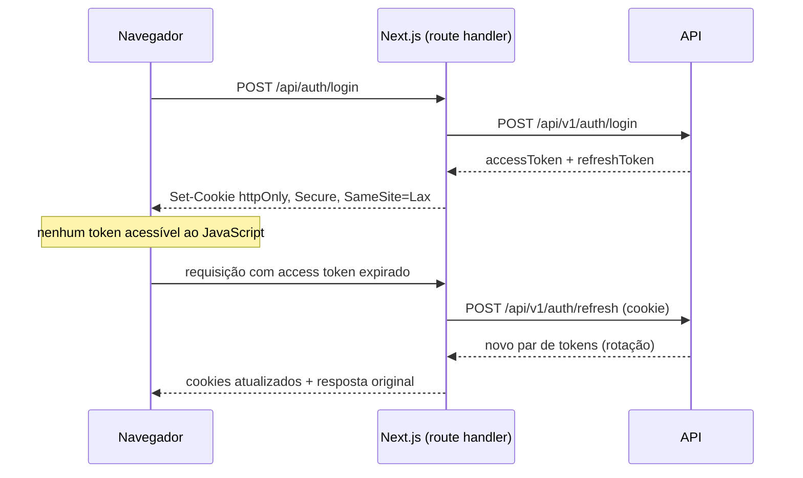

# Arquitetura do frontend

Next.js 16 com App Router ([ADR-0005](../adr/0005-frontend-nextjs-app-router.md)).

## O que roda onde

A decisão mais consequente do App Router é essa fronteira. Nossa regra:

| Roda no servidor (RSC)          | Roda no cliente                           |
| ------------------------------- | ----------------------------------------- |
| Carga inicial de listas e notas | Editor de texto                           |
| Metadados e SEO                 | Atalhos de teclado, arrastar e soltar     |
| Redirecionamentos de sessão     | Salvamento automático e estado otimista   |
| Leitura de cookies              | Qualquer coisa com `useState`/`useEffect` |

`'use client'` é marcado o mais fundo possível na árvore: um componente cliente
arrasta todos os seus filhos para o bundle.

## Estrutura

```text
src/
├── app/
│   ├── (auth)/login/ · register/ · forgot-password/
│   ├── (app)/
│   │   ├── layout.tsx           # sidebar, atalhos, guarda de sessão
│   │   ├── page.tsx             # notas recentes
│   │   ├── notes/[id]/page.tsx
│   │   ├── notebooks/[id]/page.tsx
│   │   └── search/page.tsx
│   ├── api/
│   │   ├── auth/refresh/route.ts
│   │   └── uploads/sign/route.ts
│   └── layout.tsx
├── features/
│   └── notes/
│       ├── api/                 # chamadas + query keys
│       ├── hooks/               # useNote, useNoteAutosave
│       ├── components/
│       └── types.ts
├── components/                  # componentes específicos da app
├── lib/
│   ├── api-client.ts            # fetch com refresh automático
│   ├── auth.ts                  # leitura de sessão no servidor
│   └── query-client.ts
└── styles/
```

`features/` agrupa por domínio, não por tipo de arquivo: tudo que envolve notas
fica junto. Só o que é genuinamente compartilhado sobe para `components/` e `lib/`.

## Sessão e tokens



Por que passar pelo Next.js em vez de falar direto com a API do navegador:
token em `localStorage` é roubável por qualquer XSS. Cookie `httpOnly` não é.
O custo é um salto extra de rede; a troca vale a pena.

## Estado

Três categorias, três ferramentas — misturá-las é a origem da maioria dos bugs
de sincronia de UI:

| Categoria                  | Ferramenta                | Exemplo                 |
| -------------------------- | ------------------------- | ----------------------- |
| Estado de servidor         | TanStack Query            | notas, cadernos, tags   |
| Estado de UI local         | `useState` / `useReducer` | modal aberto, aba ativa |
| Estado de UI compartilhado | Zustand (mínimo)          | sidebar recolhida, tema |

Estado de servidor **nunca** é copiado para um store global. O cache do Query é a
fonte de verdade no cliente.

## Editor

TipTap (ProseMirror), com Markdown como formato persistido — portável, diffável e
independente do editor. O texto rico é uma camada de apresentação sobre ele.

Salvamento automático: debounce de 800 ms, atualização otimista e rascunho em
IndexedDB. Se a rede cair no meio, o texto não se perde.

## Desempenho e acessibilidade

Metas verificadas na CI (Lighthouse CI em PRs que tocam a web):

- LCP < 2,5 s e CLS < 0,1 em 4G simulado
- Bundle inicial da rota de notas abaixo de 200 KB comprimido
- WCAG 2.1 AA: navegação completa por teclado, foco visível, contraste ≥ 4,5:1
- Toda ação com atalho também é alcançável por clique
