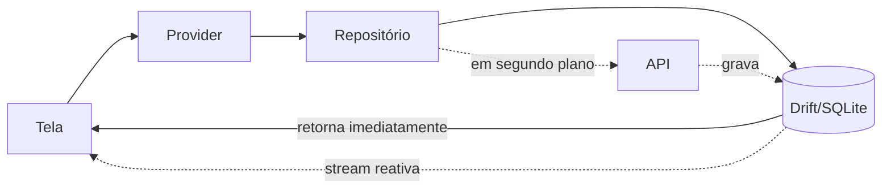

# Arquitetura do app mobile

Flutter 3.41, Android e iOS a partir de uma base só
([ADR-0006](../adr/0006-mobile-flutter-riverpod.md)).

A premissa que organiza tudo: **o app funciona sem rede**. A rede é uma otimização,
não um pré-requisito. Isso empurra o banco local para o centro do desenho.

## Camadas

Clean Architecture por feature, três camadas:

```text
presentation  →  domain  ←  data
   (UI)        (regras)   (fontes)
```

```text
lib/features/notes/
├── domain/
│   ├── entities/note.dart              # objeto puro, sem JSON, sem Drift
│   ├── repositories/notes_repository.dart   # interface
│   └── usecases/create_note.dart
├── data/
│   ├── models/note_model.dart          # freezed + json_serializable
│   ├── datasources/
│   │   ├── notes_local_datasource.dart    # Drift
│   │   └── notes_remote_datasource.dart   # Dio
│   └── repositories/notes_repository_impl.dart
└── presentation/
    ├── providers/                      # Riverpod
    ├── screens/
    └── widgets/
```

O repositório é onde local e remoto se encontram. A UI nunca conversa com a rede
diretamente — ela pede ao repositório, que decide de onde vem o dado.

## Fluxo de leitura: local primeiro, sempre



A tela renderiza do SQLite em milissegundos e se atualiza sozinha quando a rede
responde, porque observa uma stream do Drift. Nunca há um spinner esperando a
internet para mostrar algo que já está no dispositivo.

## Gerência de estado

Riverpod, com três tipos de provider:

| Tipo               | Uso                                        |
| ------------------ | ------------------------------------------ |
| `Provider`         | Dependências (Dio, banco, repositórios)    |
| `StreamProvider`   | Listas observando o Drift                  |
| `NotifierProvider` | Estado de tela com ações (editor, filtros) |

Nenhum `BuildContext` circula pelas camadas de domínio e dados — o que mantém a
lógica testável sem `WidgetTester`.

## Armazenamento

| O quê                  | Onde                     | Por quê                                           |
| ---------------------- | ------------------------ | ------------------------------------------------- |
| Notas, cadernos, tags  | Drift (SQLite)           | Consulta relacional, streams reativas, migrations |
| Fila de sincronização  | Drift                    | Precisa sobreviver ao app ser morto               |
| Tokens de autenticação | `flutter_secure_storage` | Keychain (iOS) / Keystore (Android)               |
| Preferências de UI     | `shared_preferences`     | Dados triviais, sem valor de segurança            |

Token **nunca** vai para `shared_preferences`: é texto plano.

## Rede

Dio com interceptors, nesta ordem:

1. **AuthInterceptor** — injeta o `Bearer`; em `401`, tenta o refresh **uma vez**,
   serializa as requisições concorrentes numa única renovação e repete a original.
2. **RetryInterceptor** — backoff exponencial em erro de rede e `5xx`; nunca em `4xx`.
3. **LoggingInterceptor** — só em builds de debug.

O cliente de API é gerado a partir do [OpenAPI](../api/openapi.yaml): o app não
escreve modelos de request/response à mão.

## Sincronização

Descrita em detalhe em [offline-sync.md](offline-sync.md) — leitura obrigatória
antes de tocar em `core/sync/`.

## Testes

| Nível      | Ferramenta          | O que cobre                                  |
| ---------- | ------------------- | -------------------------------------------- |
| Unitário   | `test` + `mocktail` | Casos de uso, mapeamentos, motor de sync     |
| Widget     | `flutter_test`      | Telas e estados de carregamento/erro/vazio   |
| Integração | `integration_test`  | Fluxos completos, incluindo offline → online |

O motor de sincronização tem meta de cobertura de 95%: é onde um bug vira perda de
dado do usuário.
