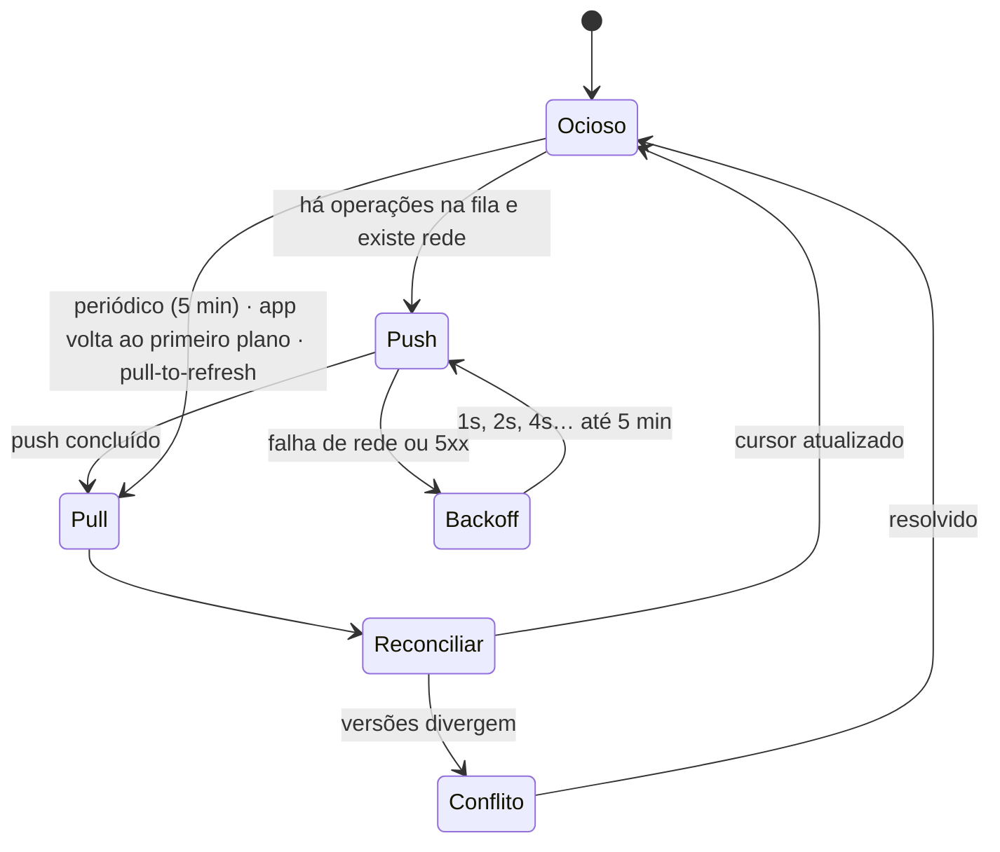

# Offline e sincronização

Este é o documento mais importante do projeto para quem for mexer no app mobile.
Sincronização é onde bugs viram **perda de dado do usuário** — e um usuário que
perde uma nota não volta.

## Premissa

O app mobile é offline-first: a rede é uma otimização, não um pré-requisito. Toda
escrita acontece primeiro no SQLite local e só depois é propagada. A UI nunca
espera a rede para confirmar uma ação do usuário.

## Peças

| Peça              | Onde                         | Papel                                         |
| ----------------- | ---------------------------- | --------------------------------------------- |
| Banco local       | `drift` (SQLite)             | Espelho local do domínio                      |
| Fila de operações | Tabela `sync_queue` no drift | Escritas pendentes, na ordem em que ocorreram |
| Cursor            | `last_sync_at` por usuário   | Marca até onde já baixamos                    |
| Motor de sync     | `core/sync/`                 | Orquestra push, pull e conflitos              |

## Ciclo



Push sempre antes de pull. A ordem importa: enviar o que é local antes de baixar
o remoto reduz a janela em que uma edição local pode ser sobrescrita.

## Push

```http
POST /api/v1/sync/push
{
  "operations": [
    {
      "opId": "018f2e9a-...",           // UUID v7 gerado no cliente
      "type": "note.update",
      "entityId": "018f2e12-...",
      "baseVersion": 7,                  // versão que o cliente viu
      "clientUpdatedAt": "2026-08-28T14:03:11.221Z",
      "payload": { "title": "...", "content": "..." }
    }
  ]
}
```

Dois pontos não negociáveis:

- **`opId` torna o push idempotente.** A rede vai duplicar requisições — é questão
  de quando, não de se. O servidor guarda os `opId` já aplicados por 7 dias e ignora
  repetições. Sem isso, um timeout na hora errada duplica notas.
- **`baseVersion` é o que detecta conflito.** Se a versão no servidor não é a que
  o cliente viu, alguém editou no meio do caminho.

Resposta:

```json
{
  "applied": [{ "opId": "018f2e9a-...", "entityId": "...", "version": 8 }],
  "conflicts": [
    {
      "opId": "018f2e9b-...",
      "entityId": "...",
      "reason": "version_mismatch",
      "serverVersion": 12,
      "serverState": { "title": "...", "content": "...", "updatedAt": "..." }
    }
  ],
  "rejected": [{ "opId": "...", "reason": "not_found" }]
}
```

O servidor devolve o **estado dele** junto com o conflito. Assim o cliente resolve
sem uma segunda viagem de rede.

## Pull

```http
GET /api/v1/sync/pull?cursor=2026-08-28T14:00:00.000Z&limit=200
```

Devolve tudo que mudou desde o cursor — incluindo exclusões, como _tombstones_
(`{ id, deletedAt }`). Sem tombstone, uma nota apagada em um dispositivo ressuscita
no outro.

O cursor é um timestamp do **relógio do servidor**, nunca do cliente. Relógio de
celular erra, atrasa e é ajustado pelo usuário; o do servidor é a única referência
confiável.

Para evitar perder registros com o mesmo timestamp, o cursor de continuação é
`(updatedAt, id)` e a paginação é estritamente ordenada por esse par.

## Conflitos

A estratégia depende do tipo de mudança:

| Situação                            | Resolução                                                                                    |
| ----------------------------------- | -------------------------------------------------------------------------------------------- |
| Só um lado mudou                    | Aplica direto — o caso comum                                                                 |
| Metadados (fixado, arquivado, tags) | Last-write-wins por `clientUpdatedAt`                                                        |
| Conteúdo, mudanças disjuntas        | Merge automático de 3 vias, usando a versão base comum                                       |
| Conteúdo, mudanças sobrepostas      | **Preserva as duas**: mantém a do servidor e cria uma nota "(cópia em conflito)" com a local |
| Exclusão vs. edição                 | A edição vence — a nota volta da lixeira                                                     |

A regra de ouro: **na dúvida, duplique; nunca descarte.** Uma nota duplicada é um
incômodo de dez segundos. Uma nota perdida é um usuário perdido.

O merge de 3 vias precisa da versão base — por isso o cliente guarda o último
conteúdo sincronizado de cada nota, além do conteúdo atual.

## Casos que a implementação precisa tratar

Esta lista virou a suíte de testes do motor de sync — cada item é um teste:

1. App morto pelo SO no meio do push → a fila sobrevive, nada é aplicado duas vezes.
2. Push aplicado no servidor mas a resposta se perde → o retry com o mesmo `opId` é ignorado.
3. Dois dispositivos editam a mesma nota offline → conflito preservado dos dois lados.
4. Nota criada e apagada offline, sem nunca ir ao servidor → as duas operações se
   cancelam localmente; nada é enviado.
5. Relógio do dispositivo adiantado em horas → o cursor do servidor não é afetado.
6. Token expirado no meio do sync → renova e retoma de onde parou.
7. Fila com mil operações → envia em lotes de 100, com progresso visível.
8. Conta encerrada em outro dispositivo → o pull responde `401` e o app limpa os
   dados locais após confirmação.

## Limites conhecidos

- **Sem edição simultânea em tempo real.** Duas pessoas na mesma nota ao mesmo
  tempo geram cópia de conflito, não merge ao vivo. Resolver isso de verdade exige
  CRDT — registrado como fora de escopo no [roadmap](../roadmap.md).
- **Anexos não são sincronizados offline.** Ficam sob demanda, baixados quando há
  rede. Sincronizar binários grandes por conexão móvel custa caro para o usuário.
- **A janela de idempotência é de 7 dias.** Um dispositivo que fique mais de uma
  semana offline com operações pendentes pode, em teoria, duplicar. Aceitável
  diante do custo de guardar `opId` indefinidamente.
