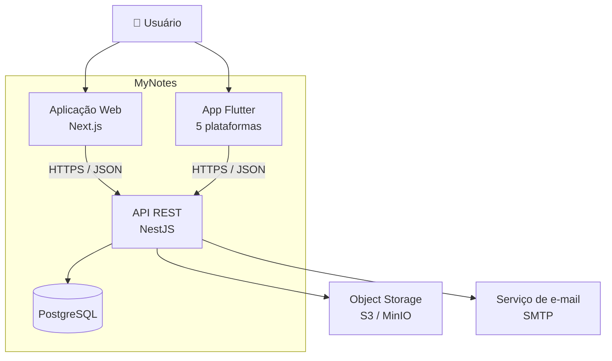
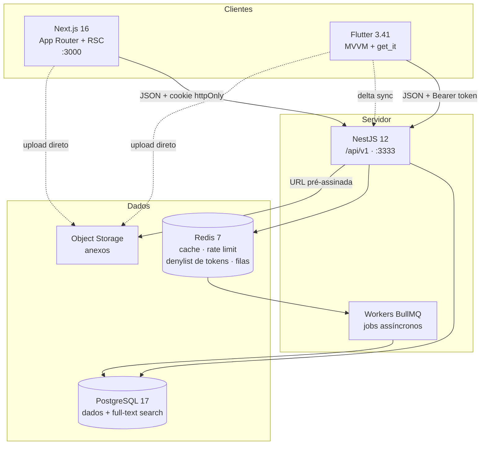
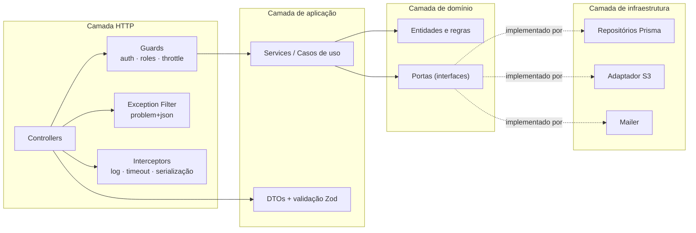
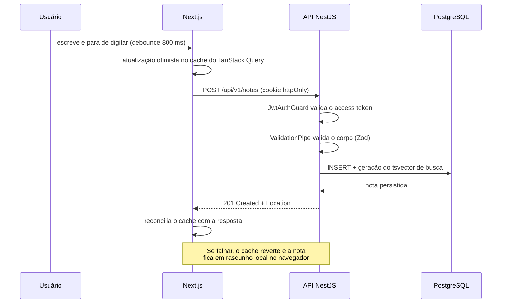
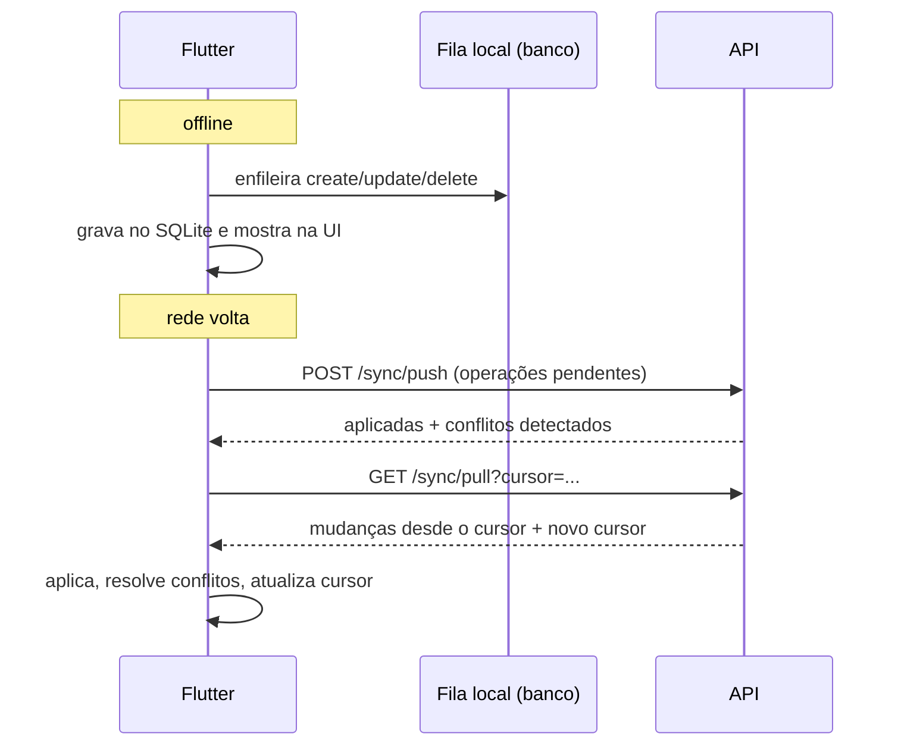

# Visão geral da arquitetura

## O que o MyNotes é

Uma plataforma de notas pessoais com três superfícies — API, web e mobile — sobre
um único domínio. A regra que organiza tudo: **o servidor é a autoridade sobre o
domínio; os clientes são caches inteligentes dele.**

Três características moldam o desenho:

1. **Multiplataforma de verdade** — a mesma nota, coerente em qualquer superfície.
2. **Offline-first no mobile** — escrever sem rede é o caso normal.
3. **Contrato antes da implementação** — o OpenAPI é escrito antes do código
   ([ADR-0007](../adr/0007-contrato-api-openapi-first.md)).

## Nível 1 — Contexto

## Nível 2 — Contêineres

Por que o upload de anexo vai direto ao storage: o binário nunca passa pela API.
Ela apenas assina uma URL temporária e registra o metadado. Isso mantém a API
leve e o custo de banda previsível.

## Nível 3 — Componentes da API

A seta pontilhada é o ponto importante: o domínio declara **portas**; a
infraestrutura as implementa. O domínio não sabe que Prisma existe — o que
permite testar regras de negócio sem banco.

## Fluxo: criar uma nota pela web

## Fluxo: sincronização do app mobile

Detalhes de conflito e limites em [offline-sync.md](offline-sync.md).

## Princípios

| Princípio                             | Consequência prática                                                          |
| ------------------------------------- | ----------------------------------------------------------------------------- |
| **O servidor é a autoridade**         | Nenhum cliente inventa regra de negócio; validação do servidor é a que vale.  |
| **Contrato antes do código**          | Mexeu na API? O `openapi.yaml` muda primeiro, na mesma PR.                    |
| **Domínio independente de framework** | Regras de negócio testáveis sem HTTP e sem banco.                             |
| **Explícito melhor que mágico**       | Sem injeção implícita obscura, sem `any`, sem configuração adivinhada de env. |
| **Toda decisão relevante vira ADR**   | Ninguém precisa arqueologia de Git para entender uma escolha.                 |
| **Erro é parte do contrato**          | Todo erro sai em `problem+json` com um código estável e documentado.          |

## Limites conhecidos

Escolhas conscientes desta versão, com o gatilho para revisitar cada uma:

| Limite                                | Por quê                                                             | Revisitar quando                                         |
| ------------------------------------- | ------------------------------------------------------------------- | -------------------------------------------------------- |
| Sem edição colaborativa em tempo real | CRDT/OT multiplicaria a complexidade do sync                        | Houver demanda real de coautoria simultânea              |
| Sem criptografia ponta a ponta        | Impede busca no servidor e recuperação de conta                     | Surgir requisito de privacidade que justifique o custo   |
| Monolito modular na API               | Time pequeno; microsserviços custam mais do que entregam aqui       | Um módulo precisar escalar ou ser implantado em separado |
| Busca no Postgres, sem Elasticsearch  | `tsvector` + `unaccent` resolve bem até a ordem de milhões de notas | A busca virar gargalo medido, não suposto                |
