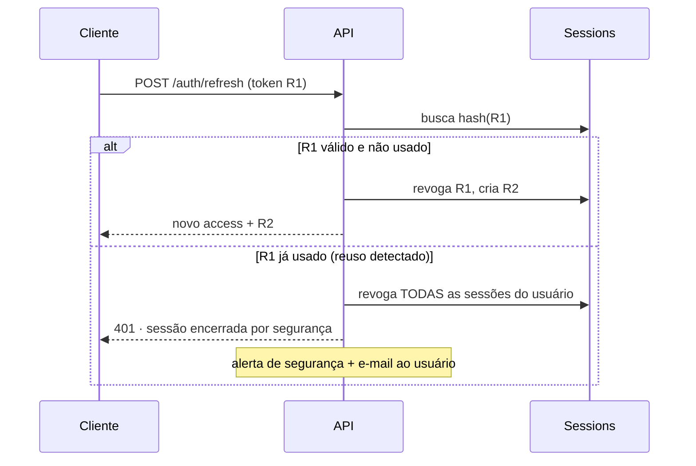

# Segurança

## Autenticação

JWT próprio, com par de tokens e rotação de refresh
([ADR-0004](../adr/0004-auth-jwt-refresh-rotativo.md)).

| Token   | Duração    | Onde vive                                            | Formato              |
| ------- | ---------- | ---------------------------------------------------- | -------------------- |
| Access  | 15 minutos | Memória (web: cookie `httpOnly`; mobile: memória)    | JWT assinado HS256   |
| Refresh | 30 dias    | Cookie `httpOnly` (web) · Keychain/Keystore (mobile) | Opaco, hash no banco |

O refresh **não é um JWT**. É um valor aleatório de 256 bits cujo hash SHA-256 é o
que fica no banco. Vazamento do dump não dá acesso a nada — e a revogação é real,
não uma lista de exceções sobre um token que continua válido.

### Rotação e detecção de reuso



Reuso de refresh token significa uma de duas coisas: o token foi roubado, ou uma
corrida de rede duplicou a chamada. Tratamos os dois casos do mesmo jeito —
derrubar todas as sessões — porque o custo de um falso positivo (o usuário
faz login de novo) é muito menor que o de um falso negativo.

### Senhas

Argon2id, com `memoryCost=19456 KiB`, `timeCost=2`, `parallelism=1` — os parâmetros
mínimos recomendados pelo OWASP. Nunca bcrypt novo; nunca SHA de qualquer sabor.

Requisitos de senha: mínimo de 12 caracteres, verificada contra a lista de senhas
vazadas (k-anonymity via Have I Been Pwned). Não exigimos "um símbolo e uma
maiúscula" — a evidência é que essa regra produz senhas piores, não melhores.

## Autorização

Todo recurso pertence a um usuário. O `OwnershipGuard` verifica isso **antes** do
caso de uso rodar, e a consulta ao banco sempre inclui `user_id` na cláusula:

```ts
// certo: escopo aplicado na consulta
await this.prisma.note.findFirst({ where: { id, userId } });

// errado: busca e depois compara — abre janela para IDOR
const note = await this.prisma.note.findUnique({ where: { id } });
if (note.userId !== userId) throw new ForbiddenException();
```

A segunda forma funciona, mas basta um `if` esquecido para virar vazamento. A
primeira torna o erro impossível.

**Recurso de outro usuário responde `404`, não `403`** — `403` confirmaria a
existência do recurso a quem não deveria saber dela.

## Modelo de ameaças

| Ameaça                   | Mitigação                                                                                                                              |
| ------------------------ | -------------------------------------------------------------------------------------------------------------------------------------- |
| Roubo de token via XSS   | Cookies `httpOnly` + `SameSite=Lax` + CSP restritiva; token nunca em `localStorage`                                                    |
| CSRF                     | `SameSite=Lax` + token anti-CSRF nos route handlers que mudam estado                                                                   |
| SQL injection            | Prisma parametriza tudo; `$queryRaw` só com template tag, revisão obrigatória na PR                                                    |
| IDOR                     | Escopo por `user_id` na consulta + `OwnershipGuard`; `404` em vez de `403`                                                             |
| Força bruta em login     | Rate limit por IP **e** por e-mail; atraso progressivo; CAPTCHA após 10 falhas                                                         |
| Enumeração de contas     | Login e recuperação de senha respondem igual para e-mail existente ou não                                                              |
| Upload malicioso         | Tipo MIME verificado por conteúdo, não por extensão; limite de tamanho; `Content-Disposition: attachment`; servido de domínio separado |
| Vazamento em logs        | Redação de `password`, `token`, `authorization` no logger; nunca logar corpo de request de auth                                        |
| Dependência comprometida | `pnpm audit` e Dependabot na CI; lockfile obrigatório                                                                                  |
| Segredo commitado        | Gitleaks na CI, em todo o histórico                                                                                                    |

## Cabeçalhos e transporte

Helmet com política explícita:

```text
Content-Security-Policy: default-src 'self'; img-src 'self' data: blob:;
                         script-src 'self'; style-src 'self' 'unsafe-inline';
                         connect-src 'self' https://api.mynotes.app
Strict-Transport-Security: max-age=31536000; includeSubDomains; preload
X-Content-Type-Options: nosniff
X-Frame-Options: DENY
Referrer-Policy: strict-origin-when-cross-origin
```

TLS 1.3 obrigatório em produção; HTTP redireciona, não atende.

## Rate limiting

Contadores no Redis, janela deslizante:

| Rota                         | Limite                                       |
| ---------------------------- | -------------------------------------------- |
| `POST /auth/login`           | 5 por minuto por IP · 10 por hora por e-mail |
| `POST /users`                | 3 por hora por IP                            |
| `POST /auth/forgot-password` | 3 por hora por e-mail                        |
| `POST /sync/push`            | 60 por minuto por usuário                    |
| Demais rotas autenticadas    | 300 por minuto por usuário                   |

Resposta ao estourar: `429` com `Retry-After`.

## Dados pessoais

O conteúdo de uma nota é dado pessoal, e frequentemente sensível.

- **Minimização**: coletamos e-mail e nome. Nada além.
- **Exportação**: `GET /users/me/export` devolve tudo em JSON — direito de portabilidade.
- **Exclusão**: `DELETE /users/me` apaga em cascata em até 30 dias, com confirmação por e-mail.
- **Retenção de logs**: 90 dias; logs de acesso não contêm conteúdo de nota.
- **Backups**: criptografados em repouso, retenção de 30 dias, restauração testada
  trimestralmente ([operations/runbook.md](../operations/runbook.md)).

## Reportar uma vulnerabilidade

Ver [SECURITY.md](../../SECURITY.md) na raiz. Resumo: não abra issue pública.

## Checklist de revisão

Toda PR que toca autenticação, autorização ou dados de usuário:

- [ ] Consulta escopada por `user_id`, não filtrada depois
- [ ] Erro de recurso alheio responde `404`
- [ ] Entrada validada por schema, incluindo limites de tamanho
- [ ] Nada sensível em log ou em mensagem de erro
- [ ] Rate limit definido para a rota nova
- [ ] Teste cobrindo o caso de acesso negado
