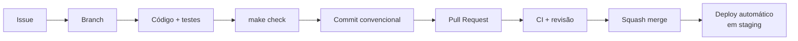

# Fluxo de desenvolvimento

Do primeiro commit ao merge.

## O ciclo



## 1. Antes de escrever código

Toda mudança começa em uma issue. Não é burocracia: é onde se discute **o que**
fazer, antes de gastar um dia fazendo a coisa errada.

Se a mudança envolve uma decisão cara de reverter, escreva a ADR **antes** —
[ver quando](../adr/README.md#quando-escrever-uma-adr).

Se muda o contrato da API, atualize o [`openapi.yaml`](../api/openapi.yaml) primeiro
e peça revisão só dele. Discutir contrato depois da implementação pronta é discutir
com o custo afundado pesando na balança.

## 2. Branch

```bash
git checkout main && git pull
git checkout -b feat/busca-por-tags
```

Padrão: `<tipo>/<descrição-curta-em-kebab-case>`. Tipos são os mesmos dos commits
([git-workflow.md](git-workflow.md)).

## 3. Desenvolvendo

Rode só o que você está mexendo:

```bash
pnpm --filter @mynotes/api dev
pnpm --filter @mynotes/api test -- --watch
```

**Escreva o teste junto, não depois.** Não por dogma de TDD, mas porque teste
escrito depois testa o que o código faz — e não o que ele deveria fazer.

## 4. Antes de commitar

```bash
make check
```

O hook de `pre-commit` roda o lint-staged automaticamente, mas `make check` é o que
reproduz a CI inteira. Rodar antes economiza o ciclo de "push, espera, falha".

## 5. Commit

Conventional Commits, com escopo:

```bash
git commit -m "feat(api): busca de notas por múltiplas tags"
```

O hook de `commit-msg` valida o formato. Detalhes e exemplos em
[git-workflow.md](git-workflow.md).

## 6. Pull Request

O template pede o essencial. Três coisas que fazem diferença na revisão:

- **Explique o porquê**, não o quê — o diff já mostra o quê.
- **Diga como verificar.** O revisor precisa reproduzir, não confiar.
- **PR pequena.** Acima de ~400 linhas, a qualidade da revisão despenca. Se a
  mudança é grande, quebre em uma sequência de PRs.

## 7. Revisão

Como autor:

- Responda a todo comentário, mesmo que seja "vou deixar como está, porque X".
- Discordar é bem-vindo; ignorar não.
- Não force-push depois que a revisão começou — quebra a visualização incremental.
  Faça commits novos; o squash no merge limpa o histórico.

Como revisor:

- Comece pela descrição e pelos testes. Eles dizem o que o autor achou que estava fazendo.
- Separe o que **bloqueia** do que é **sugestão**. Prefixe: `blocking:` / `nit:`.
- Aponte o problema, não a pessoa. "Este acesso não está escopado por usuário",
  não "você esqueceu de novo".
- Elogie o que ficou bom. Revisão só com apontamento negativo desgasta o time.

**Uma aprovação basta** para merge. Toca autenticação, dados de usuário ou o motor
de sync? Duas.

## 8. Merge

**Squash merge**, sempre. `main` fica com um commit por mudança, legível e
reversível. A mensagem do squash é a do PR — escreva-a com cuidado.

Após o merge, `main` vai automaticamente para staging. Produção é promoção manual
([operations/ci-cd.md](../operations/ci-cd.md)).

## Comandos do dia a dia

```bash
pnpm dev                              # tudo
pnpm --filter @mynotes/api <script>   # um pacote
pnpm test -- --watch                  # testes em watch
pnpm --filter @mynotes/api db:studio  # inspecionar o banco
make reset                            # zerar a infraestrutura local
pnpm api:preview                      # abrir a doc da API
turbo run build --filter=...[HEAD^]   # só o que mudou desde o último commit
```

## Quando algo dá errado

Antes de reescrever tudo: [troubleshooting.md](troubleshooting.md). A maioria dos
problemas de ambiente já está catalogada lá.
