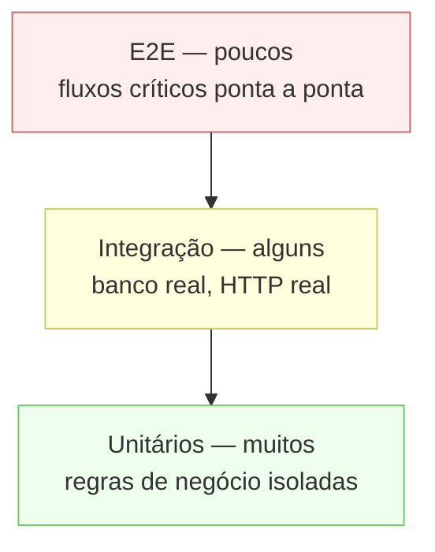

# Estratégia de testes

## Princípio

Testamos **comportamento observável**, não implementação. Um teste que quebra
quando você renomeia um método privado não estava testando nada de útil — estava
duplicando o código.

Quando um teste falha, ele deve dizer _o que o usuário deixaria de conseguir fazer_.

## Pirâmide



Muitos testes rápidos na base; poucos testes caros no topo. Inverter isso produz
uma suíte lenta que ninguém roda.

## Metas de cobertura

| Área                   | Meta       | Por quê                                                     |
| ---------------------- | ---------- | ----------------------------------------------------------- |
| Casos de uso (API)     | 90%        | É onde as regras de negócio vivem                           |
| Motor de sync (mobile) | 95%        | Bug aqui = perda de dado do usuário                         |
| Repositórios           | Integração | Cobertura de linha diz pouco; o que importa é a query rodar |
| Componentes de UI      | 70%        | Foco em estados de carregamento, erro e vazio               |
| Utilidades             | 100%       | São pequenas e puras; não há desculpa                       |

Cobertura é sintoma, não meta. 100% de cobertura com asserções fracas é pior que
70% com testes que verificam o que importa.

## Backend

### Unitários

Vitest. Caso de uso com repositórios em memória — sem Docker, sem rede,
milissegundos por teste.

```ts
describe('UpdateNoteUseCase', () => {
  it('rejeita a atualização quando a versão enviada está desatualizada', async () => {
    const repo = new InMemoryNotesRepository([noteFixture({ id, version: 5 })]);
    const useCase = new UpdateNoteUseCase(repo);

    await expect(useCase.execute({ id, userId, version: 3, title: 'x' })).rejects.toThrow(
      VersionConflictError,
    );
  });

  it('não permite ler nota de outro usuário', async () => {
    const repo = new InMemoryNotesRepository([noteFixture({ id, userId: 'outro' })]);
    const useCase = new UpdateNoteUseCase(repo);

    await expect(useCase.execute({ id, userId: 'eu', title: 'x' })).rejects.toThrow(
      NoteNotFoundError,
    );
  });
});
```

O segundo teste é o tipo que importa mais: cobre uma regra de segurança que um
refactor poderia silenciosamente remover.

### Integração

Testcontainers: um Postgres real, descartável, por execução da suíte. Testa o que
mock nenhum testa — a query de fato funciona, o índice é usado, a constraint dispara.

```ts
beforeAll(async () => {
  container = await new PostgreSqlContainer('postgres:17-alpine').start();
  await runMigrations(container.getConnectionUri());
});
```

### E2E

Supertest contra a aplicação Nest completa. Cobre fluxos, não endpoints isolados:

- Cadastro → login → criar nota → listar → editar → lixeira → restaurar
- Login → refresh → refresh com token antigo → todas as sessões revogadas
- Push com conflito → conflito devolvido → resolução → push aceito

## Frontend

- **Componentes**: Vitest + Testing Library. Consulte por papel e texto acessível
  (`getByRole('button', { name: 'Salvar' })`), nunca por classe CSS — o teste passa
  a verificar acessibilidade de graça.
- **Hooks**: `renderHook`, com MSW interceptando a rede.
- **E2E**: Playwright, nos caminhos críticos (login, criar e editar nota, busca).

Nada de snapshot de árvore inteira: quebra a cada mudança de layout e ninguém lê o
diff — todo mundo aprova com `-u`.

## Mobile

| Nível      | Ferramenta          | Foco                                                |
| ---------- | ------------------- | --------------------------------------------------- |
| Unitário   | `test` + `mocktail` | Casos de uso, mapeadores, motor de sync             |
| Widget     | `flutter_test`      | Estados de tela: carregando, erro, vazio, com dados |
| Integração | `integration_test`  | Fluxo offline → online completo                     |

Os oito cenários listados em
[architecture/offline-sync.md](../architecture/offline-sync.md#casos-que-a-implementação-precisa-tratar)
são testes obrigatórios do motor de sync. Não são sugestões.

## Dados de teste

- **Factories, não fixtures fixas.** `noteFixture({ version: 5 })` deixa explícito
  o que importa naquele teste e usa padrões no resto.
- **Nada de dado real**, nem anonimizado. Nome de teste é `Fulano da Silva`.
- **Sem dependência de ordem.** Cada teste monta e derruba o próprio estado.
- **Sem `sleep`.** Espere por condição (`waitFor`), nunca por tempo — teste com
  `sleep` é teste que vai piscar na CI.

## Testes instáveis

Um teste que falha de forma intermitente é pior que nenhum teste: ensina o time a
ignorar a CI vermelha.

Política: instável é marcado com `.skip`, vira issue com prioridade alta e é
consertado ou removido em uma semana. Não fica "quarentenado" indefinidamente.

## Na CI

`.github/workflows/ci.yml` roda tudo em toda PR, com filtros por caminho. PR não
faz merge com a CI vermelha — sem exceção "só desta vez".
