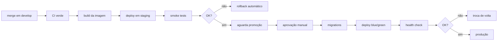

# CI/CD e deploy

## Integração contínua

Três workflows, em `.github/workflows/`:

| Workflow       | Dispara em                    | O que faz                                                |
| -------------- | ----------------------------- | -------------------------------------------------------- |
| `ci.yml`       | push e PR em `main`/`develop` | Lint, tipos, testes, build, contrato, docs               |
| `security.yml` | push, PR e semanalmente       | Auditoria de dependências, CodeQL, varredura de segredos |
| `release.yml`  | tag `v*`                      | Changelog, imagens Docker, artefatos mobile              |

### Filtros por caminho

Nem toda mudança precisa rodar tudo. O job `changes` usa `dorny/paths-filter` para
decidir o que executar:

- Mexeu em `apps/api`, `apps/web` ou `packages/` → job Node
- Mexeu em `apps/mobile` → job Flutter
- Mexeu em `docs/api/openapi.yaml` → validação do contrato
- Mexeu em Markdown → lint de docs e verificação de links

Uma PR só de documentação leva menos de um minuto. Uma que toca a API roda a suíte
completa.

### Portões obrigatórios

Nenhuma PR faz merge sem:

- [x] Formatação (`prettier --check`)
- [x] Lint sem avisos
- [x] `tsc --noEmit` limpo
- [x] Testes verdes
- [x] Build bem-sucedido
- [x] OpenAPI válido, quando alterado
- [x] Ao menos uma aprovação (duas em auth, dados de usuário ou sync)

## Ambientes

| Ambiente        | Branch    | URL                   | Deploy                         |
| --------------- | --------- | --------------------- | ------------------------------ |
| Desenvolvimento | qualquer  | localhost             | manual                         |
| Staging         | `develop` | `staging.mynotes.app` | automático a cada merge        |
| Produção        | `main`    | `mynotes.app`         | promoção manual, com aprovação |

Staging usa uma cópia anonimizada dos dados de produção, atualizada semanalmente.
Dado real nunca é copiado sem anonimização.

## Deploy



### Migrations em produção

Regra: **migrations rodam antes do deploy da aplicação nova**, e precisam ser
compatíveis com a versão **antiga** do código — que ainda está no ar durante a
transição.

Mudança destrutiva (remover coluna, renomear) vira uma sequência de três releases:

1. Adiciona a coluna nova; o código escreve nas duas.
2. Migra os dados; o código passa a ler da nova.
3. Remove a coluna antiga.

Pular etapas aqui é como se produz indisponibilidade durante o deploy.

### Blue/green

Duas versões coexistem; o tráfego muda quando o health check da nova passa. Se
algo falha, a troca de volta é imediata — sem esperar rebuild.

### Rollback

```bash
# aplicação: volta para a imagem anterior
kubectl rollout undo deployment/mynotes-api

# banco: reverte a última migration (só se ela for reversível)
pnpm --filter @mynotes/api db:rollback
```

Migration irreversível precisa de plano de rollback **escrito na PR** antes do merge.
Sem plano, não há merge.

## Mobile

Build e distribuição não seguem o mesmo ciclo — lojas têm revisão própria.

| Etapa                | Ferramenta                                |
| -------------------- | ----------------------------------------- |
| Build assinado       | Fastlane, na CI                           |
| Distribuição interna | Firebase App Distribution                 |
| Produção             | Google Play (rollout gradual) e App Store |

O rollout no Google Play começa em 10% dos usuários. Se a taxa de crash subir,
pausa-se antes de atingir a base inteira.

## Segredos

| Onde              | Como                                                      |
| ----------------- | --------------------------------------------------------- |
| CI                | GitHub Actions Secrets, por ambiente                      |
| Staging/Produção  | Gerenciador do provedor, injetado no runtime              |
| Assinatura mobile | Keystore e certificados nos secrets, nunca no repositório |

Rotação: a cada 90 dias, ou imediatamente após qualquer suspeita de vazamento.

## Métricas do pipeline

Acompanhadas mensalmente — não como meta de desempenho individual, mas para
detectar o pipeline degradando:

| Métrica                      | Alvo                      |
| ---------------------------- | ------------------------- |
| Duração da CI                | < 10 min com cache quente |
| Frequência de deploy         | Diária em staging         |
| Lead time (merge → produção) | < 1 dia                   |
| Taxa de falha em mudança     | < 15%                     |
| Tempo de recuperação         | < 1 hora                  |
