# Roadmap

Estado atual: **Fase 0 concluída.** O repositório tem a fundação do monorepo e a
documentação; as aplicações ainda não foram implementadas.

Cada fase é entregável por si só — ao final de qualquer uma delas o projeto
está em um estado coerente e demonstrável.

```mermaid
gantt
    title Fases do MyNotes
    dateFormat X
    axisFormat %s
    section Fundação
    Fase 0 — Monorepo e documentação      :done, f0, 0, 1
    section Backend
    Fase 1 — API núcleo                   :active, f1, 1, 3
    section Web
    Fase 2 — Aplicação web                :f2, 3, 5
    section Mobile
    Fase 3 — App Flutter offline-first    :f3, 5, 8
    section Maturidade
    Fase 4 — Colaboração e produção       :f4, 8, 10
```

## Fase 0 — Fundação ✅

- [x] Monorepo com pnpm workspaces + Turborepo
- [x] Padrões de código: Prettier, EditorConfig, Conventional Commits, hooks de Git
- [x] Infraestrutura local com Docker Compose (Postgres, Redis, MinIO, MailDev)
- [x] Pipelines de CI e de segurança
- [x] Documentação de arquitetura, ADRs, guias e contrato OpenAPI

## Fase 1 — API núcleo

Objetivo: uma API utilizável, testada e documentada.

- [x] Bootstrap do NestJS, configuração validada por Zod, health checks
- [x] Prisma: schema inicial e primeira migration (seed pendente)
- [x] Tratamento de erros em `problem+json` com catálogo de códigos
- [x] Autenticação: cadastro, login, refresh rotativo, logout, sessões ativas
- [x] Usuário: perfil, troca de senha, exclusão agendada de conta
- [ ] Recuperação de senha por e-mail (`forgot-password` / `reset-password`)
- [ ] Job de expurgo das contas com exclusão agendada vencida
- [ ] Notas: CRUD, lixeira, arquivamento, favoritos
- [ ] Tags
- [ ] Busca full-text em português (`tsvector` + `unaccent`)
- [ ] Rate limiting e logs estruturados
- [ ] Testes: unitários por caso de uso, integração com Testcontainers, E2E de fluxos
- [ ] `@mynotes/contracts` gerado a partir do OpenAPI

**Pronto quando**: o `openapi.yaml` inteiro está implementado e a suíte E2E cobre
os fluxos de autenticação e de notas.

## Fase 2 — Aplicação web

- [ ] Next.js com App Router e sessão em cookies `httpOnly`
- [ ] Design system inicial em `@mynotes/ui` + Storybook
- [ ] Editor TipTap com salvamento automático e histórico local
- [ ] Listagem, busca, filtros por tag, atalhos de teclado
- [ ] Tema claro/escuro, responsividade, acessibilidade (WCAG 2.1 AA)
- [ ] Testes de componente e E2E com Playwright

**Pronto quando**: é possível usar o MyNotes inteiro pelo navegador.

## Fase 3 — App Flutter offline-first

- [ ] Bootstrap do Flutter, tema, navegação com go_router, módulos e get_it
- [ ] Banco local em drift, espelhando o modelo do servidor
- [ ] Cliente da API gerado a partir do OpenAPI, com refresh automático de token
- [ ] Motor de sincronização: fila de operações, delta sync, resolução de conflito
- [ ] Editor mobile, busca local, modo offline completo
- [ ] Testes de widget e de integração do motor de sync

**Pronto quando**: dá para escrever offline no avião e tudo reconcilia ao voltar a rede.

## Fase 4 — Colaboração e produção

- [ ] Compartilhamento por link público e colaboração entre usuários
- [ ] Anexos com upload pré-assinado
- [ ] Versionamento de notas e restauração
- [ ] Exportação (Markdown, PDF) e importação
- [ ] OpenTelemetry ponta a ponta, dashboards e alertas
- [ ] Deploy em produção com blue/green e backups testados

## Fora de escopo (por enquanto)

Registrado para evitar rediscussão:

- **Edição colaborativa em tempo real (CRDT/OT)** — custo alto; reavaliar após a Fase 4.
- **Criptografia ponta a ponta** — inviabiliza busca no servidor; exigiria repensar a Fase 1.
- **Plugins de terceiros** — só depois de uma API pública estável.
- **Cadernos (organização hierárquica)** — retirados do escopo em 2026-08-31. A
  organização das notas fica por conta das tags, que resolvem o mesmo problema
  numa dimensão só: uma nota tem várias tags, e filtrar por elas atravessa
  qualquer agrupamento. Cadernos acrescentariam hierarquia com limite de
  profundidade, regras de ciclo e uma segunda forma de organizar — custo que só
  se paga com volume de notas que ainda não temos. Se voltarem, entram como
  tabela nova mais uma coluna anulável em `notes`: migration aditiva e rotas
  novas, ambas retrocompatíveis pelas regras da [ADR-0008](adr/0008-versionamento-da-api.md).
